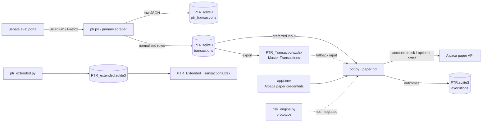
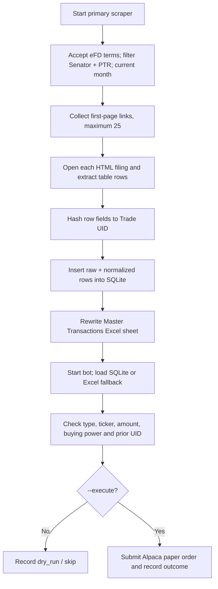

# PTR

PTR collects U.S. Senate Periodic Transaction Reports (PTRs) from the Senate's electronic financial disclosure (eFD) portal. Its main workflow stores scraped trades in SQLite, exports an Excel workbook, and can evaluate those trades for **Alpaca paper trading**. This is a local Python command-line project, with no web interface or scheduled job configured in the repository.

## Contents

- [What is in this project](#what-is-in-this-project)
- [Architecture](#architecture)
- [Workflows and data](#workflows-and-data)
- [Run locally](#run-locally)
- [Architecture and code review](#architecture-and-code-review)
- [Product review](#product-review)
- [Priorities and open questions](#priorities-and-open-questions)
- [Naming and retained source material](#naming-and-retained-source-material)

## What is in this project

| Location | Role and current status |
| --- | --- |
| [`app/code/ptr.py`](app/code/ptr.py) | **Primary scraper.** Searches the current month, reads up to 25 HTML PTR links from the first results page, deduplicates trades, and exports an Excel sheet. |
| [`app/code/bot.py`](app/code/bot.py) | **Paper trading bot.** Reads normalized trades from SQLite, falls back to Excel, applies basic guards, and records outcomes. Default mode is a dry run; `--execute` submits orders to the configured Alpaca endpoint. |
| [`app/code/ptr_extended.py`](app/code/ptr_extended.py) | **Alternative scraper.** Supports date overrides, multiple results pages, retries, report status tracking, and several HTML extractors. Still caps processing at 25 reports and skips paper filings. It uses separate outputs. |
| [`app/code/ptr_excel_legacy.py`](app/code/ptr_excel_legacy.py) | Older Excel-only scraper retained for reference. It has no SQLite deduplication and is not part of the recommended workflow. |
| [`app/code/risk_engine.py`](app/code/risk_engine.py) | Standalone risk-rule prototype. The bot does **not** import or enforce it. |
| [`app/code/generate_mapping.py`](app/code/generate_mapping.py) | Fetches tradable Alpaca assets into `app/data/ticker_map.csv`. The bot does not consume this mapping. |
| [`app/code/generate_legend_symbols.py`](app/code/generate_legend_symbols.py) | Fetches Alpaca assets and replaces the workbook's `Legend` sheet. Runs network and file operations at import time; use with care. |
| [`app/resources/requirements.txt`](app/resources/requirements.txt) | Pinned environment snapshot containing direct and transitive dependencies. |
| `app/data/`, `app/logs/` | Local SQLite databases, Excel exports, mapping data, and runtime logs. |
| Root PDFs, EPUB, `PTR MASTER.xlsx` files, and `app/whales.xlsx` | Historical/reference material. They are not read by the active scraper or bot. The two master workbooks have different sheets and remain separate. |

No Git metadata, automated test suite, deployment configuration, or scheduler definition was present when this overview was written. The existing `app/venv/` is a copied virtual environment with old absolute paths; create a fresh environment for the renamed location.

## Architecture



The main scraper and bot now use paths derived from the application folder, so they target the same active SQLite file. The extended scraper's schema and workbook differ; it remains a separate pipeline. SQLite's primary keys and `INSERT OR IGNORE` deduplicate trades in the main path. Its WAL setting suits local use, but Selenium runs serially and Excel exports rewrite the whole workbook, limiting throughput and making concurrent runs undesirable.

## Workflows and data



### Data contracts

- `ptr_transactions`: raw scraped row JSON, report URL, senator, timestamp, keyed by `trade_uid`.
- `transactions`: normalized transaction date, owner, ticker, asset, type, reported amount range, comment, report URL, and timestamp; also keyed by `trade_uid`.
- `executions`: one row per trade UID with symbol, side, status, optional order ID, and timestamp.
- `PTR_Transactions.xlsx`: regenerated from normalized SQLite data; its active sheet is `Master Transactions`. Treat SQLite as the durable source for the primary workflow.
- `PTR_extended.sqlite3`: separate `transactions`, `reports`, and `paper_pages` schema used by the alternative scraper. Paper image collection exists in code, but the current report flow marks paper filings as skipped.

The existing primary database contained 117 normalized transactions and 97 execution records at review time. These are local snapshots, not evidence of current Senate coverage or successful paper orders. A reported amount is a **range**, so the bot sizes an order using its low end and a configured cap; the original filing does not disclose an exact trade value.

## Run locally

From the renamed project folder:

```bash
cd "/Users/Apple/Developer/PTR/app"
python3 -m venv .venv
source .venv/bin/activate
python -m pip install -r resources/requirements.txt
```

Install Firefox and a compatible geckodriver if they are absent. The primary scraper does not require Alpaca credentials:

```bash
python code/ptr.py --headless --max-reports 25
```

The bot loads `ALPACA_API_KEY` and `ALPACA_SECRET_KEY` from `app/.env`; `ALPACA_PAPER_URL` is optional. Keep that file private. Old resource notes contained credential-looking values and have been replaced; rotate those keys if they belong to an active account. A default dry run still connects to Alpaca and writes `executions` rows:

```bash
python code/bot.py --paper
```

`--execute` submits orders through an Alpaca client configured for paper mode. Check `ALPACA_PAPER_URL` before using it, because the code allows a custom API endpoint. Review the execution-state issue below: a previous dry run or skip can prevent the same UID from being considered again. There is no live-trading CLI option. The extended scraper can be run separately with `python code/ptr_extended.py --headless --max-pages 2`; its date overrides require `--allow-custom-dates`. Its outputs do not feed the main bot.

## Architecture and code review

### Software architect

**Strengths:** deterministic trade IDs, local SQLite persistence, a raw/normalized data split, an Excel export, and a paper-only broker client provide a clear foundation for a small local workflow. The extended scraper records per-report status and can traverse result pages.

**Constraints:** three overlapping scraper implementations have different schemas, UID algorithms, report coverage, and Excel behavior. Only the primary scraper and bot share a data contract. There is no orchestrator, queue, migration strategy, or documented concurrency control. The first-page/25-report cap can silently limit coverage of a busy month. The extended scraper also hard-caps reports at 25 despite a larger `--max-reports` argument.

### Software developer

**Strengths:** entry points are explicit; paths now resolve relative to the application; SQLite inserts are idempotent; and the bot defaults to dry-run with modest order limits.

**High-impact issues:**

1. `bot.py` treats **any** `executions` row as already executed, including `dry_run`, `skip`, and `error`. This makes a trial run or transient failure suppress a later paper order. Its status is not an immutable event log despite old documentation.
2. The bot checks only whether a ticker is nonblank. It does not validate listing/tradability, filing age, held quantity for sells, or the standalone `risk_engine.py` limits. The risk prototype's stop calculation does not create a stop order.
3. `ptr.py` returns the combined SQLite changes to raw and normalized tables as its “new rows” count, which can report roughly twice the number of newly normalized trades.
4. `ptr_extended.py` is large and mixes browser automation, extraction, persistence, export, and CLI logic. Broad exception handling and a global browser alias obscure failures. Its paper-image collector is currently unreachable from the active report flow.
5. `generate_legend_symbols.py` performs API calls and workbook writes at module import, and replaces a sheet that other code labels as a field legend. The primary scraper rewrites the workbook, so that added sheet will disappear on the next scrape. Historical resource notes duplicated code and contained stale paths and credential-like strings.

The dependency file is a full pinned environment snapshot, making installation heavier than the project's direct imports require. No automated tests were found; parsing, UID stability, pagination, execution transitions, and schema compatibility are the most valuable first checks to add.

## Product review

| User goal | Current experience | Gap to address |
| --- | --- | --- |
| Collect recent Senate PTRs | One command creates a local, deduplicated database and Excel export. | First page only in the primary flow; no coverage summary or completeness indicator. |
| Inspect a particular period | Extended flow accepts a month or date range when explicitly enabled. | Separate outputs and incompatible trade IDs make comparisons and bot use awkward. |
| Research filings | Excel has normalized trade rows and source URLs. | No search, dashboard, data quality flags, or paper-filing OCR. |
| Try a trading strategy safely | Paper bot defaults to dry-run and caps size/count. | Dry-run writes terminal state; no review/approval queue, replay control, or clear broker feedback for retry decisions. |
| Operate unattended | CLI and logs are present. | No scheduler config, monitoring, alerting, or recovery procedure. |

The present product fits local Senate trade research and cautious paper-trading experiments. House filings, paper OCR, live trading, and a user interface are not implemented. Any business goal around complete coverage or dependable autonomous execution needs explicit acceptance criteria before adding automation.

## Priorities and open questions

| Priority | Action | Decision or acceptance question |
| --- | --- | --- |
| P0 | Separate attempted, simulated, skipped, failed, and broker-confirmed execution states; permit deliberate retries and keep an append-only audit trail. | Should a dry run ever affect eligibility for a later paper order? |
| P0 | Add a freshness gate, tradability check, and sell-position guard before order submission; decide which `risk_engine.py` rules belong in the bot. | What maximum filing delay and portfolio exposure are acceptable? |
| P1 | Choose one scraper and one SQLite schema; migrate the useful pagination/retry features from the extended path. | Is full-month coverage or fast daily sampling the primary goal? |
| P1 | Report search pages, filings found, HTML filings processed, paper filings skipped, rows inserted, and failures separately. | What constitutes a complete, successful run? |
| P1 | Add offline checks for parsing, UID stability, date/range normalization, deduplication, and bot status transitions. | Which sample filings and broker responses should serve as fixtures? |
| P2 | Split the large scraper into browser, parser, storage, and export modules; reduce dependencies to a maintained direct list. | Does the project need a reusable library or only a CLI? |
| P2 | Add scheduling, monitoring, and a research interface after data coverage and execution safety are established. | Who uses the outputs, and what decisions must the UI support? |

## Naming and retained source material

The project, master workbooks, and active outputs are named **PTR**. “Senator” remains where it describes a real filer type, database field, or source document; changing those terms would change the meaning of the data. Original PDFs, EPUB, legacy databases, logs, and virtual-environment files are retained as historical or generated artifacts. The canonical project documentation is this file; `app/resources/` contains short reference pointers and dependency pins.
